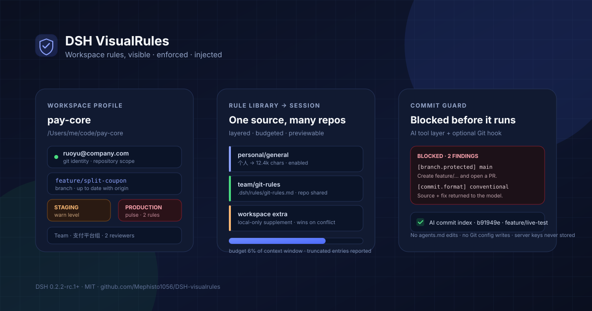

# dsh-visualrules

<div align="center">
  <b>Workspace profiles, team rules, commit validation, and session-scoped rule injection for DeepSeek Harness</b><br />
  <sub>See the rules. Enforce the commit. Teach the model. Leave the repository untouched.</sub>
</div>

<br />

<div align="center">
  <a href="https://github.com/Mephisto1056/DSH-visualrules"></a>
  <a href="https://opensource.org/licenses/MIT"></a>
  <a href="https://nodejs.org">=20" src="https://img.shields.io/badge/node-%3E%3D20-339933?logo=node.js&logoColor=white" /></a>
  
</div>

<div align="center">
  🌏 <a href="./README_ZH.md">中文</a> · <b>English</b>
</div>

<div align="center">
  
</div>

## Why this plugin

A DSH session can move between repositories, teams, and environments in a single afternoon. Each place has its own Git identity, branch convention, protected branches, commit format, and review policy. Most of that knowledge lives in `CONTRIBUTING.md`, a commitlint config, a group chat, or somebody's memory — invisible to the model and easy to violate at 2 a.m.

**dsh-visualrules** turns those rules into a first-class workspace surface:

- **Visible** — the session header shows the environment; one click opens identity, branch, remote, environment, and rule summary in the native right sidebar.
- **Enforced** — AI-issued `git commit` / branch creation passes a rule engine before it runs, and an optional pair of Git hooks covers the terminal, IDE, scripts, and background tasks.
- **Injected** — enabled rule packs are appended to the session's system prompt, scoped to the session directory, budgeted against the model context window, and previewable before you enable them.
- **Traceable** — every block, warning, one-time bypass, and AI-authored commit hash is indexed locally.

The plugin never edits `agents.md`, never writes the repository, never changes Git config, and never stores a password, token, or private-key content.

## Features

| | |
|---|---|
| **🗂️ Workspace profile**<br/>Git `user.name` / `user.email` with their actual scope, environment level with colour semantics, branch / remote / upstream / ahead-behind, protected-branch and naming warnings, team owner and contacts, toolchain and CI expectations.<br/><sub>F1.1–F1.8</sub> | **🧾 Team configuration**<br/>A read-only `.dsh/profile.yaml` inside the repository. YAML errors report the line and field path; unknown fields are ignored with a notice; personal fields in the team layer are refused, not trusted.<br/><sub>F4.1–F4.4</sub> |
| **📚 Rule packs**<br/>Create, import Markdown, edit, enable globally or per workspace, and reuse one pack across repositories. Team packs can live in the repository (`file:`) or inline (`content:`), and stay read-only in the plugin.<br/><sub>F0.1, F0.4, F0.6</sub> | **💉 Session injection**<br/>Personal → team → workspace supplement, with the later layer winning. A live preview shows the exact text, character count, budget, and truncation before the next model step receives it.<br/><sub>F0.2, F0.3, F0.5</sub> |
| **🛡️ Commit validation**<br/>Identity, protected branch, branch naming, Conventional Commits, allowed types, scope, header length, linked Issue, merge-message mismatch, and `--no-verify` visibility. Every rule is `off / info / warn / block` per workspace.<br/><sub>F2.1–F2.4, F2.6</sub> | **🤖 Model-facing rejection**<br/>A blocked tool call returns the violated rule, its source, and a concrete fix. The model reads it in the next step and can retry correctly — no opaque “command failed”. `visualrules_check` lets it pre-flight a message or branch.<br/><sub>F2.8</sub> |
| **🪝 Optional Git hooks**<br/>Two managed hooks (`pre-commit`, `commit-msg`) cover human commits. An existing hook is backed up and still runs first; uninstall restores it. A `core.hooksPath` outside the repository is refused.<br/><sub>F2.9</sub> | **🔓 User-only bypass**<br/>A blocked commit can be released for exactly one commit with a written reason and a 5–30 minute TTL. The agent cannot create a bypass; only the UI can.<br/><sub>F2.7</sub> |
| **🧭 AI commit index**<br/>Successful AI-issued commits are recorded by session, repository, branch, author, and full hash — local index only, never written into the commit or Git notes.<br/><sub>F3.8</sub> | **🔎 Existing rule sources**<br/>Read-only discovery of commitlint (JSON / YAML / static JS), `.editorconfig`, eslint config, `CONTRIBUTING.md`, and the PR template. Values fill gaps instead of duplicating a second rulebook.<br/><sub>F4.7</sub> |
| **🌏 Native UI, light and dark**<br/>A session-header entry, a right-sidebar quick preview, a full profile page, and a Settings section — theme tokens only, English and Chinese dictionaries.<br/><sub>F1.8, F4.6</sub> | **🪶 Optional by default**<br/>No rule pack is enabled on install. Server information stays off until explicitly enabled. Disabling validation or removing the plugin leaves Git and DSH untouched. |

## Installation

### From a local checkout (available today)

```sh
git clone https://github.com/Mephisto1056/DSH-visualrules.git
cd DSH-visualrules
npm install
```

Then install the package into your DSH profile. The exact profile name is the one you launch (`desktop`, `web`, …):

```sh
dsh plugin --profile desktop add /absolute/path/to/DSH-visualrules
```

Or, inside a DSH session, ask the agent to install the bundle with `plugin_manager` using the absolute package directory. After installation, **hard-refresh the browser** (`Cmd/Ctrl + Shift + R`): the host half activates immediately, but the client bundle is loaded by the page.

### From npm (after release)

```sh
dsh plugin --profile desktop add dsh-visualrules@latest
```

See [docs/compatibility.md](./docs/compatibility.md) for the supported DSH line. This plugin is built and tested against DSH **0.2.2-rc.1+**; the peer floor moves only when a host API changes.

### First run

1. Open a session in a Git repository.
2. Click the shield icon at the **left edge of the session-header utility cluster** (or the sidebar shield icon for the full page).
3. Open **Validation** and review the effective rules. Nothing is blocked until a team rule or a configured personal expectation applies.
4. Add `.dsh/profile.yaml` to the repository and commit it — the team shares one rule source.
5. Optionally enable a rule pack and check **Injection preview** to see exactly what the model will receive.

## Quick start

### 1. Commit a team profile

```yaml
# .dsh/profile.yaml — committed, read-only to the plugin
version: 1
team: 支付平台组
environment: staging
environments:
  - { name: dev, host: dev.example.com, level: dev }
  - { name: staging, host: stg.example.com, level: warn }
  - { name: prod, host: prod.example.com, level: danger }
git:
  branch_pattern: "^(feature|fix|hotfix)/[a-z0-9-]+$"
  commit_format: conventional
  allowed_commit_types: [feat, fix, docs, refactor, test, chore]
  header_max_length: 72
  require_issue: true
  merge_strategy: squash
  protected_branches: [main, "release/*"]
  review:
    min_approvals: 2
dev:
  toolchain: { node: "20.x", python: "3.11" }
  lint: eslint
  test: [unit-test]
  ci_required: [lint, unit-test]
docs:
  wiki: https://example.com/wiki
  issues: https://example.com/board
team_info:
  owner: 张三
  contacts: [张三 · 负责人 · zhang@example.com]
  release_window: 每周四 20:00
packs:
  - id: team/git-rules
    title: 团队提交规范
    file: .dsh/rules/git-rules.md
```

The full annotated example lives in [`examples/profile.yaml`](./examples/profile.yaml).

### 2. Try a protected-branch commit

On `main`, ask the model to commit. The tool call is rejected before Git runs:

```text
Git 提交被 DSH VisualRules 拦截（2 条阻断）。

1. [branch.protected] 受保护分支
   当前分支 main 命中受保护规则 main，团队约定不允许直接提交。
   来源：.dsh/profile.yaml
   修正：创建特性分支（例如 git switch -c feature/<name>）后提交，并通过 PR/MR 合并。
2. [commit.format] 提交信息格式不符合 Conventional Commits
   首行「update」不符合 <type>(<scope>): <subject>。
   来源：.dsh/profile.yaml
   修正：例如：feat(auth): 支持手机号登录。
```

The next model step sees this text. It can create the branch and retry without guessing.

### 3. Enable a rule pack

Open **Workspace → Rule packs → New**, or use **Create the default pack** from an empty state. Tick a pack on for the current workspace. The right-sidebar preview and the Injection preview update immediately; the next request uses the new text. Changes apply on the **next model request**, never retroactively.

### 4. Cover human commits (optional)

On **Validation → Git hooks**, preview the exact files, then install. The plugin writes `.git/hooks/pre-commit` and `.git/hooks/commit-msg` with a managed marker. If either hook already exists, it is moved to `*.dsh-visualrules-original` and runs first. Uninstall removes only managed files and restores the originals.

Prefer the terminal? The same operations are available headlessly:

```sh
node scripts/hooks.mjs status
node scripts/hooks.mjs install
node scripts/hooks.mjs uninstall
```

## Commit validation rules

| Rule id | Default | What it checks |
| --- | --- | --- |
| `identity.email` | warn | Actual Git email differs from the personal expected email. |
| `identity.missing` | warn | `user.name` or `user.email` is empty. |
| `branch.protected` | **block** | Current branch matches a team `protected_branches` pattern. |
| `branch.pattern` | warn | Branch name does not match `branch_pattern`. |
| `branch.detached` | warn | Committing on a detached HEAD. |
| `commit.format` | **block** | Header does not match `commit_format` (Conventional Commits or a custom regex). |
| `commit.type` | **block** | Type is outside `allowed_commit_types` / commitlint `type-enum`. |
| `commit.scope` | warn | Scope is outside commitlint `scope-enum`. |
| `commit.headerLength` | warn | Header exceeds `header_max_length` / commitlint `header-max-length`. |
| `commit.issue` | **block** | `require_issue: true` and no issue reference is found. |
| `commit.messageMissing` | warn | The command did not reveal a message (`-m` / `-F` / amend). |
| `commit.mergeMessage` | warn | A `Merge …` commit under `merge_strategy: squash`. |
| `commit.noVerify` | warn | The command uses `--no-verify`, so repository hooks will be skipped. |
| `commit.amend` | info | The command rewrites the previous commit. |

Levels are resolved as: built-in default → team rule presence → per-workspace override. The **Validation** page edits the per-workspace map and shows the effective source.

### Two layers, stated honestly

| Path | Covered by | Notes |
| --- | --- | --- |
| AI runs `git commit` through the tool layer | plugin guard | Model-readable rejection; covers normal agent commits. |
| Terminal, IDE, scripts, background jobs | optional Git hooks | Enabled per repository; existing hooks are chained. |
| `git commit --no-verify` | **not coverable locally** | The hook cannot run; the tool guard still sees the command string. Server-side protection and CI remain authoritative. |

### One-time bypass

A blocked commit can be released once from **Validation → One-time bypass**. The reason (≥ 3 characters) and a 5–30 minute expiry are stored locally; the next matching commit consumes the record and shows the reason in the warning. This is deliberately a **user-only** operation: the agent has no tool to create or extend a bypass.

## Configuration

### Team layer — `.dsh/profile.yaml` (in the repository, read-only)

| Field | Type | Meaning |
| --- | --- | --- |
| `version` | integer | Config version; unknown future fields are ignored with a notice. |
| `team` | string | Display name of the team. |
| `environment` | string | Current environment; `environments[].level` controls the colour and prod emphasis. |
| `environments[]` | array | `{ name, host, port, level, jump, note }`; only `name` / `level` are required for display. |
| `git.branch_pattern` | regex | Branch naming rule. |
| `git.commit_format` | `conventional` or regex | Commit header format. |
| `git.allowed_commit_types` | string[] | Allowed Conventional Commits types. |
| `git.header_max_length` | integer | Maximum header length (10–500). |
| `git.require_issue` | boolean | Require an issue reference. |
| `git.issue_pattern` | regex | Issue format; default matches `#123` and `PROJ-42`. |
| `git.merge_strategy` | string | `squash`, `merge`, …; `squash` warns on `Merge …` messages. |
| `git.protected_branches` | glob[] | Supports `*` and `?`; used for display and blocking. |
| `git.review.min_approvals` | integer | Displayed review requirement. |
| `git.tag_pattern` | regex | Displayed tag rule. |
| `dev` | object | `toolchain`, `lint`, `formatter`, `test`, `ci_required`, `dirs`. |
| `docs` | object | `wiki`, `issues`, `contributing`, `pr_template`. |
| `team_info` | object | `owner`, `contacts`, `release_window`, `timezone`. |
| `packs[]` | array | Team rule packs: `{ id, title, description, file, content }`; `file` must stay inside the repository. |

`identity`, `servers`, `exclusive`, and `personal` are personal fields. If they appear in the team file, the plugin warns and refuses to use them.

### Personal / workspace layer — DSH local storage (never in the repository)

| Field | Meaning |
| --- | --- |
| `gitName`, `gitEmail` | Expected identity used by warnings and the hook snapshot. |
| `environment` | Personal override; a warning appears if it hides a team environment. |
| `showServerInfo` | Explicit consent required before host / user / key reference leave the Host. |
| `servers[name]` | `{ user, keyRef }` — a login name and a **reference name**, never a secret. |
| `enabledPacks` / `disabledPacks` | Per-workspace pack references; a disabled pack wins over a global default. |
| `injectRules` | Inject the structured team Git rules directly. |
| `extraRules` | Workspace-only Markdown supplement (last layer). |
| `validation.enabled` | Master switch for commit validation. |
| `validation.levels` | Per-rule override map. |
| `validation.confirmDanger` | Ask before destructive commands in a `prod` workspace. |
| `validation.trackCommits` | Record successful AI commits locally. |

### Rule sources discovered from the repository

When present, the plugin reads — never executes — these files and uses them to fill gaps in the effective rules:

- commitlint: `commitlint.config.{js,cjs,mjs,ts}`, `.commitlintrc(.json|.yaml|.yml|.js|.cjs)`, or `package.json#commitlint`
- `.editorconfig` (`indent_style`, `indent_size`, `max_line_length`)
- eslint config (presence and path)
- `CONTRIBUTING.md` and the GitHub PR template (path and title)

JavaScript commitlint configs are parsed statically; anything opaque produces an explicit notice instead of a guessed rule.

## How injection works

```
session directory
      │
      ├── personal packs (global default or explicitly enabled)
      ├── team packs     (enabled, from .dsh/profile.yaml)
      ├── structured Git rules (injectRules)
      └── workspace supplement (last, wins on conflict)
      │
      ▼
compose → header (cwd / branch / environment) → budget check
      │
      ▼
systemPrompt.section(), per Agent, per request
```

- Registered as a **session-scoped** section, so no session id ever appears in the text and nothing global leaks across agents.
- Recomposed on every request from the session's **current directory**; changing a workspace directory invalidates the next assembly.
- Budget defaults to about **6% of the model context window** (fallback 24k characters), with more specific layers retained first. Truncated and omitted entries are reported in the preview.
- Disabling a pack, changing levels, or removing a profile applies on the next request. No restart, no `agents.md` edit.
- The commit-feedback section is separate and short; it only appears after a guard rejection or warning and is cleared naturally as the session moves on.

## UI surfaces

| DSH slot | Content |
| --- | --- |
| `conversation.session.header.utilities` | Header shield + environment dot + warning badge, `order: -20`. |
| `sidebarRightTabs` + `sidebar.right.pane.tab` | Native right-sidebar quick preview. |
| `shell.overlay` | Fallback when the right sidebar is unavailable. |
| `sidebar.panellist` + `main` | Full workspace profile page: Overview, Validation, Packs, Personal, Team, Injection preview. |
| `settings.section` | Rule packs, validation, personal configuration, injection preview. |

## Host API

All routes are mounted on the shared `/api` fetch handler behind DSH's normal connection trust fence. They are intentionally private to the plugin's Client half; there is no cross-origin surface.

| Route | Purpose |
| --- | --- |
| `POST /api/visualrules/profile` | Assembled workspace profile. |
| `POST /api/visualrules/preview` | Exact injection text, budget and truncation. |
| `POST /api/visualrules/library` | Personal packs, team packs, workspaces, template. |
| `POST /api/visualrules/packs/save` · `/packs/delete` | Personal pack CRUD; team packs stay read-only. |
| `POST /api/visualrules/workspace/save` · `/workspace/toggle` | Personal / workspace settings and pack enablement. |
| `POST /api/visualrules/validation/status` · `/save` · `/check` | Rule levels, hook status, recent events, pre-flight check. |
| `POST /api/visualrules/bypass/create` · `/revoke` | User-only one-time bypass. |
| `POST /api/visualrules/hook/status` · `/preview` · `/install` · `/uninstall` | Managed Git hooks. |
| `POST /api/visualrules/commits/list` · `/delete` · `/clear` | Local AI commit index. |
| `POST /api/visualrules/refresh` | Force-refresh profile caches. |

Model-facing tools: `visualrules_check` (pre-flight) and `visualrules_status` (read-only summary).

## Safety boundaries

- Team configuration is **read-only**. The plugin never writes `.dsh/profile.yaml`; the template is copy-only.
- The only repository writes are the optional Git hooks, with an explicit preview and a reversible install.
- The plugin never changes Git config, never commits, never pushes, and never runs a destructive Git operation on its own.
- Server information is off by default; enabling it asks for confirmation. Only login names and key **reference names** are stored.
- Secrets, tokens, and private keys are never requested, read, or persisted.
- A broken configuration, a non-Git directory, an unavailable storage domain, or a failed rule evaluation degrades to display-only; it never blocks DSH or Git.
- Local validation is an assistant, not a gatekeeper. `--no-verify`, another machine, and server-side settings are outside its reach.

## Compatibility

- DSH **0.2.2-rc.1+** (verified on the desktop profile).
- Node.js **20+** for the standalone hook runner (`node` must be on `PATH` for Git hooks).
- macOS, Linux, and Windows Git Bash are supported by the hook scripts; the UI follows the host theme.
- No native dependencies; the only runtime dependencies are `yaml` and `zod`.

## Development

```sh
npm install
npm run check     # syntax + manifest + export surface
npm test          # 73 tests: rules, command parsing, sources, hooks, guard, API, profile, injection
npm run verify    # check + test
```

Repository layout:

```
lib/
  index.js              Host entry: storage, API, prompt sections
  client.js             Client entry: header, sidebar, page, settings
  host/
    rules.js            Pure commit/branch rule engine
    command.js          Shell/Git command parser
    guard.js            tools/pre-execute, tools/result, model tools
    hooks.js            Managed Git hooks
    sources.js          commitlint / editorconfig / eslint / docs discovery
    store.js            storageDomain tables and validation
    team-config.js      .dsh/profile.yaml loader and line-aware errors
    profile.js          Profile assembly
    injection.js        Layered prompt composition and budget
    git.js              Read-only Git probes
  hook/check.mjs        Standalone hook runner
test/                   Node test runner suites
docs/                   Configuration, validation, architecture, release
```

Useful local commands:

```sh
node scripts/hooks.mjs status
node scripts/hooks.mjs install
node scripts/hooks.mjs uninstall
```

## Roadmap

- **0.1** — workspace profile, rule packs, injection, sidebar preview, settings (shipped).
- **0.2** — commit validation, tool guard, Git hooks, one-time bypass, AI commit index, existing rule sources (this release).
- **Next** — multi-document packs, Git graph as a separate product evaluation, SVN adapter, external linter config linkage, optional CI status markers.
- **Out of scope** — pushing, committing on the user's behalf, or replacing server-side branch protection and CI.

## FAQ

<details>
<summary>Nothing is blocked. Why?</summary>

Commit validation only acts when a rule exists: a team `git` rule, an expected personal email, or a per-workspace override. A fresh install with no `.dsh/profile.yaml` has nothing to enforce. Check **Validation → Rules** for the effective values.

</details>

<details>
<summary>The header icon is missing.</summary>

The entry is rendered only while a session is open; the blank Hero has no header utilities. The full page remains reachable from the sidebar shield icon, and Settings always has the Validation section.

</details>

<details>
<summary>I changed a rule pack but the model did not change.</summary>

Injection is assembled per request. Start a new step/turn; opening a new session is not required. The preview shows exactly what the next request will carry.

</details>

<details>
<summary>Why did a commit pass even though the message looks wrong?</summary>

Check the rule level. `warn` and `info` never block; only `block` does. Also check whether the message came from a file (`-F`), a heredoc, or an `--amend`; the guard reads those forms, and an unparsable message is reported as `commit.messageMissing`.

</details>

<details>
<summary>Does uninstalling the plugin remove the hooks?</summary>

Hooks are deliberately independent of the plugin process: they must keep working while DSH is closed. Uninstall them from **Validation → Git hooks** or `node scripts/hooks.mjs uninstall` before removing the plugin. The managed hook itself degrades to a warning and exits 0 if the checker path disappears, so a missing plugin never bricks a commit.

</details>

<details>
<summary>Where is my data stored?</summary>

Rule packs, personal settings, bypass records, validation events, and the AI commit index live in the DSH storage domain `dsh_visualrules` (`~/.dsh/storages/dsh_visualrules.json` on macOS). The team profile stays in the repository; the plugin only reads it.

</details>

## Contributing

Issues and pull requests are welcome. Please read [`CONTRIBUTING.md`](./CONTRIBUTING.md) and the repository rules in [`AGENTS.md`](./AGENTS.md). Before opening a PR:

```sh
npm run verify
```

For a behavior change, add a test that fails without the change. For a UI change, describe the workspace state and the surface you checked.

## License

[MIT](./LICENSE) © 2026 dsh-visualrules contributors.

---

<div align="center">
  <sub>Built for the <a href="https://github.com/deepseek-ai/deepseek-harness">DeepSeek Harness</a> ecosystem.</sub>
</div>
