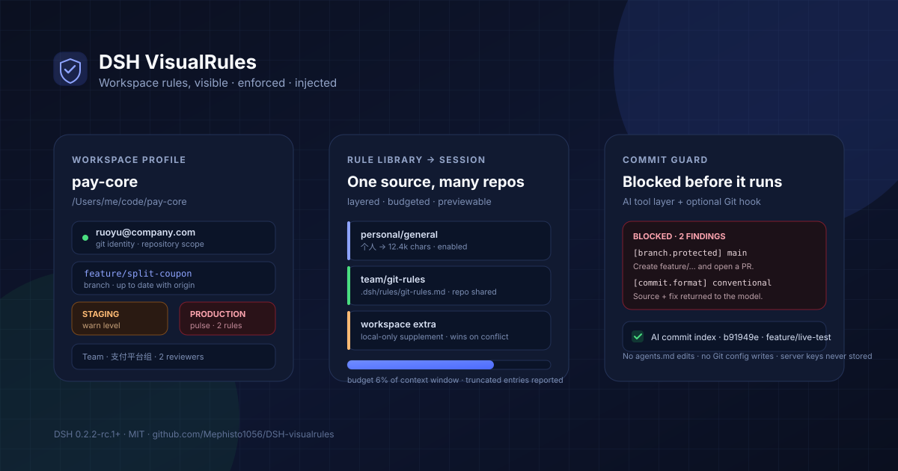

# dsh-visualrules

<div align="center">
  <b>DeepSeek Harness 的工作区档案、团队规范、提交校验与会话级规范注入</b><br />
  <sub>看得到规则，拦得住提交，教得会模型，又不碰仓库。</sub>
</div>

<br />

<div align="center">
  <a href="https://github.com/Mephisto1056/DSH-visualrules"></a>
  <a href="https://github.com/Mephisto1056/DSH-visualrules/actions/workflows/ci.yml"></a>
  <a href="https://opensource.org/licenses/MIT"></a>
  <a href="https://nodejs.org">=20" src="https://img.shields.io/badge/node-%3E%3D20-339933?logo=node.js&logoColor=white" /></a>
  
</div>

<div align="center">
  🌏 <b>中文</b> · <a href="./README.md">English</a>
</div>

<div align="center">
  
</div>

## 为什么需要它

一个 DSH 会话可能一下午在多个仓库、团队和环境之间切换。每个地方都有自己的 Git 身份、分支约定、受保护分支、提交格式和评审要求。这些规则通常散落在 `CONTRIBUTING.md`、commitlint 配置、群公告和某个人的记忆里——模型看不见，深夜赶工时最容易踩。

**dsh-visualrules** 把这些规则变成工作区的一等公民：

- **看得到**：会话头部显示环境色点，点开右侧栏一屏看完身份、分支、远端、环境和规则摘要。
- **管得住**：AI 发起的 `git commit` 和建分支先过规则引擎；可选的两个 Git 钩子覆盖终端、IDE、脚本与后台任务。
- **守得住**：启用的规范包按会话目录注入系统提示，按模型上下文预算截断，启用前可完整预览。
- **可追溯**：每次拦截、警告、临时放行和 AI 提交 hash 都留在本机索引里。

插件不修改 `agents.md`、不写仓库、不改 Git 配置，也不保存任何密码、token 或私钥内容。

## 功能

| | |
|---|---|
| **🗂️ 工作区档案**<br/>Git 用户名 / 邮箱及实际来源、环境级别与配色、分支 / 远端 / 上下游 / 领先落后、受保护分支与命名提醒、团队负责人和联系人、工具链与 CI 要求。<br/><sub>F1.1–F1.8</sub> | **🧾 团队配置**<br/>仓库内只读的 `.dsh/profile.yaml`。YAML 错误带行号和字段路径；未知字段忽略并提示；个人字段出现在团队层会被拒绝使用。<br/><sub>F4.1–F4.4</sub> |
| **📚 规范包**<br/>新建、导入 Markdown、编辑；可全局启用或按工作区启用；一份规范跨仓库复用。团队包可放仓库（`file:`）或内联（`content:`），在插件里保持只读。<br/><sub>F0.1、F0.4、F0.6</sub> | **💉 会话注入**<br/>个人 → 团队 → 工作区补充，后层优先。预览显示下一轮模型会收到的完整文本、字符数、预算与截断情况。<br/><sub>F0.2、F0.3、F0.5</sub> |
| **🛡️ 提交校验**<br/>身份、受保护分支、分支命名、Conventional Commits、允许类型、scope、首行长度、Issue 关联、合并提交、`--no-verify`。每条规则可按工作区设为 `关闭 / 提示 / 警告 / 拦截`。<br/><sub>F2.1–F2.4、F2.6</sub> | **🤖 回传模型**<br/>被拦截的工具调用返回违反的规则、来源和具体修正方式。模型下一轮能读懂并改正后重试。`visualrules_check` 可提前试算。<br/><sub>F2.8</sub> |
| **🪝 可选 Git 钩子**<br/>`pre-commit` + `commit-msg` 覆盖人工提交。已有钩子会备份并先执行；卸载时恢复。`core.hooksPath` 指向仓库外时拒绝安装。<br/><sub>F2.9</sub> | **🔓 仅用户可用的临时放行**<br/>写原因、5–30 分钟有效、一次提交后失效。AI 没有放行工具，只有界面能创建。<br/><sub>F2.7</sub> |
| **🧭 AI 提交索引**<br/>记录 AI 发起并成功的提交：会话、仓库、分支、作者、完整 hash。只存本机，不写提交内容，也不写 Git notes。<br/><sub>F3.8</sub> | **🔎 复用现有规范源**<br/>只读解析 commitlint（JSON / YAML / 静态 JS）、`.editorconfig`、eslint、`CONTRIBUTING.md` 和 PR 模板；已有值优先，不另造一份规则。<br/><sub>F4.7</sub> |
| **🌏 原生界面，明暗主题**<br/>会话头部入口、右侧栏快速预览、完整档案页、设置页；只用主题令牌，中英双语。<br/><sub>F1.8、F4.6</sub> | **🪶 默认全部可选**<br/>安装后不启用任何规范包；服务器信息默认关闭且需二次确认；关闭校验或卸载插件不影响 Git 与 DSH。 |

## 安装

### 从本地目录安装（当前可用）

```sh
git clone https://github.com/Mephisto1056/DSH-visualrules.git
cd DSH-visualrules
npm install
```

然后装进 DSH profile（profile 名就是你启动时用的 `desktop` / `web` 等）：

```sh
dsh plugin --profile desktop add /absolute/path/to/DSH-visualrules
```

也可以在 DSH 会话里让 agent 用 `plugin_manager` 的 `install_bundle` 安装这个目录。装完**硬刷新浏览器**（`Cmd/Ctrl + Shift + R`）：Host 立即生效，但 Client 代码由页面加载。

### 从 npm 安装（发布后）

```sh
dsh plugin --profile desktop add dsh-visualrules@latest
```

支持线见 [docs/compatibility.md](./docs/compatibility.md)：本插件按 DSH **0.2.2-rc.1+** 开发与验证。

### 第一次使用

1. 在 Git 仓库里打开一个会话。
2. 点会话头部工具区最左侧的盾牌图标（完整档案页由左侧栏盾牌图标进入）。
3. 打开「校验」页看当前生效的规则；没有团队规则或个人期望时不会拦截任何东西。
4. 在仓库里加 `.dsh/profile.yaml` 并提交，团队共用一份规则。
5. 按需启用规范包，并在「注入预览」里确认真实文本。

## 快速开始

### 1. 提交团队配置

```yaml
# .dsh/profile.yaml —— 随仓库提交，插件只读
version: 1
team: 支付平台组
environment: staging
environments:
  - { name: dev, host: dev.example.com, level: dev }
  - { name: staging, host: stg.example.com, level: warn }
  - { name: prod, host: prod.example.com, level: danger }
git:
  branch_pattern: "^(feature|fix|hotfix)/[a-z0-9-]+$"
  commit_format: conventional
  allowed_commit_types: [feat, fix, docs, refactor, test, chore]
  header_max_length: 72
  require_issue: true
  merge_strategy: squash
  protected_branches: [main, "release/*"]
  review:
    min_approvals: 2
dev:
  toolchain: { node: "20.x", python: "3.11" }
  lint: eslint
  test: [unit-test]
  ci_required: [lint, unit-test]
docs:
  wiki: https://example.com/wiki
  issues: https://example.com/board
team_info:
  owner: 张三
  contacts: [张三 · 负责人 · zhang@example.com]
  release_window: 每周四 20:00
packs:
  - id: team/git-rules
    title: 团队提交规范
    file: .dsh/rules/git-rules.md
```

完整注释示例见 [`examples/profile.yaml`](./examples/profile.yaml)。

### 2. 在 main 上试一次提交

模型发起提交时，工具层在 Git 真正执行前拒绝：

```text
Git 提交被 DSH VisualRules 拦截（2 条阻断）。

1. [branch.protected] 受保护分支
   当前分支 main 命中受保护规则 main，团队约定不允许直接提交。
   来源：.dsh/profile.yaml
   修正：创建特性分支（例如 git switch -c feature/<name>）后提交，并通过 PR/MR 合并。
2. [commit.format] 提交信息格式不符合 Conventional Commits
   首行「update」不符合 <type>(<scope>): <subject>。
   来源：.dsh/profile.yaml
   修正：例如：feat(auth): 支持手机号登录。
```

模型下一步会读到这段文本，可以自己建分支、改信息后重试。

### 3. 启用规范包

打开「工作区规范 → 规范包 → 新建」，或在空状态里点「创建并启用默认规范包」。为当前工作区勾选后，右侧预览和注入预览立即更新；**下一轮模型请求**生效，不追溯已发生的对话。

### 4. 覆盖人工提交（可选）

在「校验 → Git 钩子」里先看将写入的文件，再安装。插件写入 `.git/hooks/pre-commit` 和 `.git/hooks/commit-msg`；已有同名钩子会被移到 `*.dsh-visualrules-original` 并先执行。卸载只删除带标记的文件并恢复原钩子。

终端里也能操作：

```sh
node scripts/hooks.mjs status
node scripts/hooks.mjs install
node scripts/hooks.mjs uninstall
```

## 校验规则

| 规则 id | 默认 | 检查内容 |
| --- | --- | --- |
| `identity.email` | 警告 | 实际 Git 邮箱与个人层期望不一致。 |
| `identity.missing` | 警告 | `user.name` 或 `user.email` 为空。 |
| `branch.protected` | **拦截** | 当前分支命中团队 `protected_branches`。 |
| `branch.pattern` | 警告 | 分支名不匹配 `branch_pattern`。 |
| `branch.detached` | 警告 | 在 detached HEAD 上提交。 |
| `commit.format` | **拦截** | 首行不符合 `commit_format`（Conventional 或自定义正则）。 |
| `commit.type` | **拦截** | 类型不在 `allowed_commit_types` / commitlint `type-enum`。 |
| `commit.scope` | 警告 | scope 不在 commitlint `scope-enum`。 |
| `commit.headerLength` | 警告 | 首行超过 `header_max_length` / commitlint 上限。 |
| `commit.issue` | **拦截** | `require_issue: true` 但信息里没有 Issue 编号。 |
| `commit.messageMissing` | 警告 | 命令里解析不到提交信息。 |
| `commit.mergeMessage` | 警告 | `merge_strategy: squash` 下出现 `Merge …` 提交。 |
| `commit.noVerify` | 警告 | 命令带 `--no-verify`，仓库钩子会被跳过。 |
| `commit.amend` | 提示 | 本次提交会改写上一个提交。 |

级别按「内置默认 → 团队规则是否存在 → 工作区覆盖」解析；「校验」页展示实际来源。

### 两层覆盖，说清楚边界

| 路径 | 谁覆盖 | 说明 |
| --- | --- | --- |
| AI 通过工具层执行 `git commit` | 插件校验 | 拒绝原因能回传模型；覆盖常规 agent 提交。 |
| 终端、IDE、脚本、后台任务 | 可选 Git 钩子 | 按仓库开启；已有钩子串接执行。 |
| `git commit --no-verify` | **本地机制无法覆盖** | 钩子不会运行；工具层仍能看到命令。服务端保护和 CI 才是最终防线。 |

### 临时放行

被拦截的提交可以在「校验 → 临时放行」里写原因放行一次，有效期 5–30 分钟。原因会留本机记录，下一次匹配的提交消费它并在警告里标出原因。**这是用户专属操作**：agent 没有创建或延长放行的工具。

## 配置说明

### 团队层 —— `.dsh/profile.yaml`（仓库内，只读）

| 字段 | 类型 | 说明 |
| --- | --- | --- |
| `version` | 整数 | 配置版本；未知的未来字段忽略并提示。 |
| `team` | 字符串 | 团队展示名。 |
| `environment` | 字符串 | 当前环境；`environments[].level` 决定配色与生产强调。 |
| `environments[]` | 数组 | `{ name, host, port, level, jump, note }`。 |
| `git.branch_pattern` | 正则 | 分支命名。 |
| `git.commit_format` | `conventional` 或正则 | 提交首行格式。 |
| `git.allowed_commit_types` | 字符串数组 | 允许的提交类型。 |
| `git.header_max_length` | 整数 | 首行上限（10–500）。 |
| `git.require_issue` | 布尔 | 是否要求关联 Issue。 |
| `git.issue_pattern` | 正则 | Issue 格式；默认认 `#123` 与 `PROJ-42`。 |
| `git.merge_strategy` | 字符串 | 如 `squash`；为 squash 时对 `Merge …` 警告。 |
| `git.protected_branches` | glob 数组 | 支持 `*` / `?`；用于展示和拦截。 |
| `git.review.min_approvals` | 整数 | 展示评审人数要求。 |
| `git.tag_pattern` | 正则 | 展示 Tag 规则。 |
| `dev` | 对象 | `toolchain`、`lint`、`formatter`、`test`、`ci_required`、`dirs`。 |
| `docs` | 对象 | `wiki`、`issues`、`contributing`、`pr_template`。 |
| `team_info` | 对象 | `owner`、`contacts`、`release_window`、`timezone`。 |
| `packs[]` | 数组 | `{ id, title, description, file, content }`；`file` 必须留在仓库内。 |

`identity`、`servers`、`exclusive`、`personal` 属于个人字段；出现在团队文件里会告警并拒绝使用。

### 个人 / 工作区层 —— DSH 本机存储（永不入库）

| 字段 | 说明 |
| --- | --- |
| `gitName` / `gitEmail` | 期望身份，用于提醒和钩子快照。 |
| `environment` | 个人环境覆盖；若隐藏了团队环境会给出警告。 |
| `showServerInfo` | 显式确认后才展示 host / 用户 / 密钥引用。 |
| `servers[name]` | `{ user, keyRef }` —— 登录名和密钥**引用名**，不是密钥内容。 |
| `enabledPacks` / `disabledPacks` | 工作区引用；显式禁用优先于全局启用。 |
| `injectRules` | 直接注入结构化团队 Git 规则。 |
| `extraRules` | 仅本工作区的 Markdown 补充（最后一层）。 |
| `validation.enabled` | 提交校验总开关。 |
| `validation.levels` | 每条规则的级别覆盖。 |
| `validation.confirmDanger` | 生产环境下高危命令二次确认。 |
| `validation.trackCommits` | 记录成功的 AI 提交。 |

### 自动读取的项目规范源

只读、不执行：

- commitlint：`commitlint.config.{js,cjs,mjs,ts}`、`.commitlintrc(.json|.yaml|.yml|.js|.cjs)` 或 `package.json#commitlint`
- `.editorconfig`（`indent_style`、`indent_size`、`max_line_length`）
- eslint 配置（路径）
- `CONTRIBUTING.md` 与 GitHub PR 模板（路径和标题）

JavaScript 配置只做静态提取；读不出来的会明确提示，不会猜规则。

## 注入是怎么工作的

```
会话目录
   │
   ├── 个人规范包（全局默认或显式启用）
   ├── 团队规范包（启用，来自 .dsh/profile.yaml）
   ├── 结构化 Git 规则（injectRules）
   └── 工作区补充（最后，冲突时优先）
   │
   ▼
拼接 → 头部（目录 / 分支 / 环境）→ 预算检查
   │
   ▼
systemPrompt.section()，按 Agent、按请求组装
```

- 按**会话作用域**注册；文本里不出现会话标识，不会泄漏到别的 agent。
- 每次请求按会话**当前目录**重新解析；切换目录后下一轮生效。
- 预算约为模型上下文窗口的 **6%**（拿不到时回退 24k 字符），更具体的层优先保留；截断和未包含的条目在预览里列出。
- 关闭规范包、改级别或删除配置都在下一轮生效，不需要重启，也不修改 `agents.md`。
- 提交反馈是独立短段落，只在被拦截或出现警告后出现。

## 界面落点

| DSH 插槽 | 内容 |
| --- | --- |
| `conversation.session.header.utilities` | 头部盾牌 + 环境色点 + 警告角标，`order: -20`。 |
| `sidebarRightTabs` + `sidebar.right.pane.tab` | 右侧栏快速预览（原生标签页）。 |
| `shell.overlay` | 右侧栏不可用时的浮层回退。 |
| `sidebar.panellist` + `main` | 完整档案页：档案、校验、规范包、个人配置、团队配置、注入预览。 |
| `settings.section` | 规范包、校验、个人配置、注入预览。 |

## Host API

全部挂在共享 `/api` fetch handler 后面，受 DSH 正常的连接信任栅栏保护。

| 路由 | 用途 |
| --- | --- |
| `POST /api/visualrules/profile` | 工作区档案。 |
| `POST /api/visualrules/preview` | 注入全文、预算与截断。 |
| `POST /api/visualrules/library` | 个人包、团队包、工作区、模板。 |
| `POST /api/visualrules/packs/save` · `/packs/delete` | 个人规范包 CRUD；团队包只读。 |
| `POST /api/visualrules/workspace/save` · `/workspace/toggle` | 个人 / 工作区设置与启用状态。 |
| `POST /api/visualrules/validation/status` · `/save` · `/check` | 规则级别、钩子状态、最近记录、试算。 |
| `POST /api/visualrules/bypass/create` · `/revoke` | 用户专属一次性放行。 |
| `POST /api/visualrules/hook/status` · `/preview` · `/install` · `/uninstall` | 托管 Git 钩子。 |
| `POST /api/visualrules/commits/list` · `/delete` · `/clear` | 本机 AI 提交索引。 |
| `POST /api/visualrules/refresh` | 强制刷新缓存。 |

模型工具：`visualrules_check`（试算）与 `visualrules_status`（只读状态）。

## 安全边界

- 团队配置**只读**；插件不写 `.dsh/profile.yaml`，模板只提供复制。
- 仓库内唯一写入是可选的 Git 钩子：安装前预览，可一键卸载并恢复。
- 不改 Git 配置、不替用户提交、不推送、不自行执行破坏性 Git 操作。
- 服务器信息默认关闭；开启需二次确认。只保存登录名和密钥**引用名**。
- 不请求、不读取、不持久化密码 / token / 私钥。
- 配置损坏、非 Git 目录、存储不可用或规则解析失败时降级为展示，不阻塞 DSH 或 Git。
- 本地校验只是辅助；`--no-verify`、另一台机器和服务端设置都在它的覆盖之外。

## 开发

```sh
npm install
npm run check     # 语法 + manifest + 导出面
npm test          # 77 个用例：规则、命令解析、规范源、钩子、guard、API、档案、注入
npm run verify    # check + test
```

目录：

```
lib/
  index.js              Host 入口：存储、API、提示段
  client.js             Client 入口：头部、右侧栏、整页、设置页
  host/
    rules.js            纯规则引擎
    command.js          Shell / Git 命令解析
    guard.js            tools/pre-execute、tools/result、模型工具
    hooks.js            托管 Git 钩子
    sources.js          commitlint / editorconfig / eslint / docs 探测
    store.js            storageDomain 表与校验
    team-config.js      .dsh/profile.yaml 读取与行号错误
    profile.js          档案组装
    injection.js        分层注入与预算
    git.js              只读 Git 探测
  hook/check.mjs        独立钩子执行器
test/                   Node test runner 用例
docs/                   配置、校验、架构、发版
```

## 路线图

- **0.1** —— 工作区档案、规范包、注入、右侧栏预览、设置页（已完成）。
- **0.2** —— 提交校验、工具层拦截、Git 钩子、一次性放行、AI 提交索引、现有规范源（本版）。
- **后续** —— 多文档规范包、Git 图谱独立评估、SVN 适配层、外部 lint 配置联动、可选 CI 状态。
- **不做** —— 替用户推送 / 提交，替代服务端分支保护和 CI。

## 常见问题

<details>
<summary>为什么什么都没拦截？</summary>

校验只在存在规则时生效：团队 `git` 规则、个人期望邮箱或工作区级别覆盖。全新安装且没有 `.dsh/profile.yaml` 时没有可执行的规则。到「校验 → 规则」看实际生效值。

</details>

<details>
<summary>头部图标不见了。</summary>

入口只在打开会话时渲染，空白 Hero 没有会话头部。完整档案页仍可从左侧栏盾牌进入，设置页也一直有「校验」。

</details>

<details>
<summary>改了规范包，模型没变？</summary>

注入按请求组装。开始下一轮/下一步即可，不必新开会话；「注入预览」显示的就是下一轮会带上的文本。

</details>

<details>
<summary>为什么看起来不合规的提交却通过了？</summary>

先看规则级别：`警告` 和 `提示` 不拦截，只有 `拦截` 会。再看信息是否来自 `-F` 文件、heredoc 或 `--amend`；解析不到的会报 `commit.messageMissing`。

</details>

<details>
<summary>卸载插件会把 Git 钩子一起删掉吗？</summary>

不会。钩子必须在 DSH 关闭时也能工作，所以独立于插件进程。卸载插件前请到「校验 → Git 钩子」或 `node scripts/hooks.mjs uninstall` 卸载。若插件路径消失，托管钩子会打印警告并以 0 退出，不会把提交卡死。

</details>

<details>
<summary>数据存在哪里？</summary>

规范包、个人设置、放行记录、校验事件和 AI 提交索引存在 DSH 存储域 `dsh_visualrules`（macOS 上是 `~/.dsh/storages/dsh_visualrules.json`）。团队配置留在仓库，插件只读。

</details>

## 参与贡献

欢迎 issue 和 PR。先读 [`CONTRIBUTING.md`](./CONTRIBUTING.md) 与仓库规则 [`AGENTS.md`](./AGENTS.md)。提交前：

```sh
npm run verify
```

改行为时请加一个「去掉修复就变红」的测试；改 UI 时说明工作区状态和验证过的界面。

## 许可

[MIT](./LICENSE) © 2026 dsh-visualrules contributors。

---

<div align="center">
  <sub>为 <a href="https://github.com/deepseek-ai/deepseek-harness">DeepSeek Harness</a> 生态而做。</sub>
</div>
